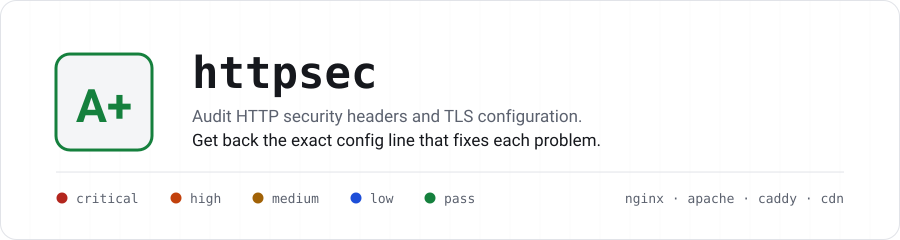
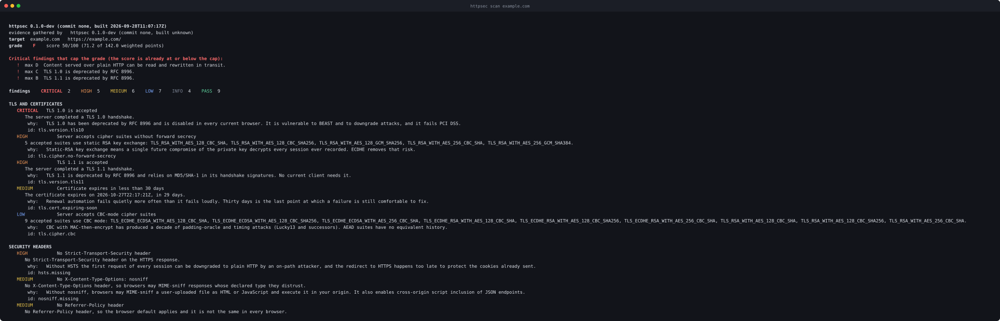
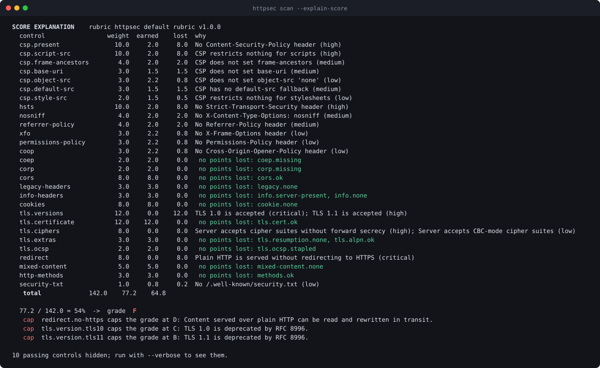
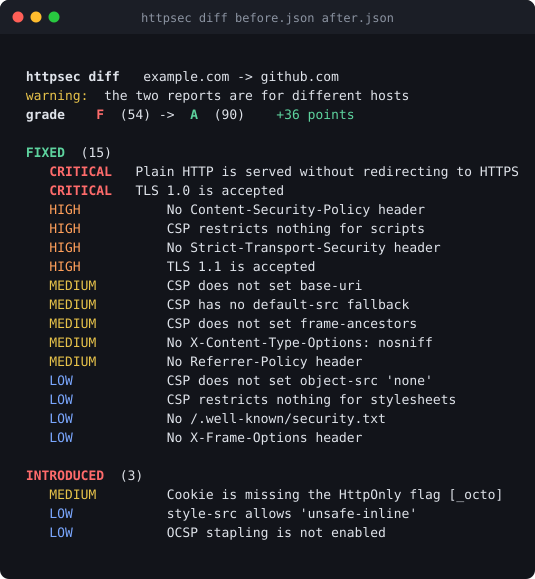

<div align="center">

<picture>
  <source media="(prefers-color-scheme: dark)" srcset="docs/images/banner-dark.svg">
  <source media="(prefers-color-scheme: light)" srcset="docs/images/banner-light.svg">
  
</picture>

<br>
<br>


<br>
<br>

<a href="#quickstart"><b>Quickstart</b></a> &nbsp;·&nbsp;
<a href="#what-it-checks"><b>What it checks</b></a> &nbsp;·&nbsp;
<a href="#every-finding-comes-with-the-fix"><b>Remediation</b></a> &nbsp;·&nbsp;
<a href="#scoring"><b>Scoring</b></a> &nbsp;·&nbsp;
<a href="#reports"><b>Reports</b></a> &nbsp;·&nbsp;
<a href="#use-it-in-ci"><b>CI</b></a> &nbsp;·&nbsp;
<a href="docs/rubric.md"><b>Rubric</b></a> &nbsp;·&nbsp;
<a href="docs/decisions.md"><b>Decisions</b></a>

</div>

<br>

## Every other tool checks whether the header exists

`httpsec` checks whether it **does anything**.

A `Content-Security-Policy` with `unsafe-inline` in `script-src`, an `https:`
wildcard and an allowlisted JSONP endpoint is barely better than no policy at
all. Here is the difference that makes:

<table>
<tr>
<th align="left" width="50%">What a header checker tells you</th>
<th align="left" width="50%">What <code>httpsec</code> tells you</th>
</tr>
<tr valign="top">
<td>

```
✔ Content-Security-Policy    present
✔ Strict-Transport-Security  present
✔ X-Frame-Options            present
✔ X-Content-Type-Options     present
```

Grade: **A**

</td>
<td>

```
HIGH   script-src allows 'unsafe-inline'
       …and no nonce or hash is present, so any
       injected script tag or inline handler runs.

HIGH   script-src allowlists ajax.googleapis.com
       Hosts AngularJS; an allowlisted Angular build
       turns any injected HTML into script execution.

MED    CSP does not set base-uri
       base-uri does not fall back to default-src.
       An injected <base> rewrites every relative
       script URL, bypassing the allowlist entirely.
```

Grade: **C**

</td>
</tr>
</table>

Then it hands you the line that fixes it, for **nginx, Apache, Caddy and a
generic CDN**.

<br>

<div align="center">
  
</div>

<br>

## Quickstart

```bash
go install github.com/dotMuny/httpsec/cmd/httpsec@latest
httpsec scan example.com
```

That is the whole setup. Go 1.22 or newer, no CGO, two dependencies, one
static binary.

<details>
<summary><b>Other ways to install</b></summary>

<br>

**From source**

```bash
git clone https://github.com/dotMuny/httpsec
cd httpsec
make build          # -> bin/httpsec
```

**With Docker**

```bash
docker build -t httpsec .
docker run --rm httpsec scan example.com
```

</details>

### The commands you will actually use

| | |
|---|---|
| `httpsec scan example.com` | Full audit |
| `httpsec scan example.com --verbose` | Include the controls that passed |
| `httpsec scan example.com --explain-score` | Justify the grade, control by control |
| `httpsec scan example.com --format html -o report.html` | A self-contained report you can send to a client |
| `httpsec scan example.com --headers-only` | Skip the TLS handshakes, for speed |
| `httpsec batch domains.txt --concurrency 10` | A fleet, with a comparison table |
| `httpsec diff before.json after.json` | What improved and what regressed |
| `httpsec remediate example.com --server nginx` | The config block that fixes everything found |
| `httpsec rubric --caps` | Print the scoring rubric from the binary |

<br>

## What it checks

<table>
<tr valign="top">
<td width="33%">

### 🔐 TLS

Protocol versions · cipher suites · suite preference · certificate chain ·
hostname match · OCSP stapling and revocation · CT SCTs · ALPN · session
resumption · secure renegotiation · compression

</td>
<td width="33%">

### 📋 CSP

A real directive parser. Wildcards · `unsafe-inline` and `unsafe-eval` ·
bypassable CDN allowlists · missing `base-uri` and `frame-ancestors` ·
`strict-dynamic` recognised as correct

</td>
<td width="33%">

### 🍪 Cookies

`Secure` · `HttpOnly` · `SameSite` · the `__Host-` and `__Secure-` prefixes
and whether the attributes actually satisfy them · over-broad `Domain` ·
multi-year lifetimes

</td>
</tr>
<tr valign="top">
<td>

### 🛡 Headers

HSTS with a parsed `max-age` · `X-Frame-Options` · `nosniff` ·
`Referrer-Policy` · `Permissions-Policy` · COOP/COEP/CORP and whether the
document ends up `crossOriginIsolated`

</td>
<td>

### 🌐 Network

HTTP→HTTPS upgrade and every hop of the chain · declared mixed content ·
`security.txt` against RFC 9116 · `OPTIONS` and `TRACE`

</td>
<td>

### 🔎 CORS & disclosure

A synthetic `Origin` and a `null` origin, to catch reflection with
credentials · headers that advertise software versions · withdrawn headers
that should be gone

</td>
</tr>
</table>

<details>
<summary><b>The Content Security Policy checks, in full</b> — this is the part that took the most work</summary>

<br>

A full directive parser, not a presence check. `httpsec` reports:

- `unsafe-inline` and `unsafe-eval` in `script-src` — and **not** when a nonce
  or hash is present, because CSP3 browsers ignore `unsafe-inline` in that
  case. Getting this wrong is how most tools produce noise.
- Wildcard sources (`*`, `https:`, `http:`) and `data:` in a script context.
- Allowlisted hosts that are **known to be bypassable**: CDNs serving
  AngularJS, JSONP endpoints, and buckets that host arbitrary user content.
  [The list is data](data/csp-bypass.json), with a reason per host.
- Missing `default-src`, `object-src 'none'`, `base-uri` and
  `frame-ancestors` — the last two do not fall back to `default-src`, which is
  the single most common CSP mistake.
- `'strict-dynamic'` with a nonce, recognised as the **right** shape. It
  suppresses the host-allowlist findings, because browsers ignore them.
- `report-uri` without `report-to`.
- Unknown, deprecated, duplicated and empty directives.
- A Report-Only policy with nothing enforced, reported for what it is: no
  policy.

</details>

<details>
<summary><b>The TLS checks, in full</b></summary>

<br>

- **Protocol versions** — a separate handshake per version, 1.0 through 1.3.
- **Cipher suites** — TLS 1.2 suites enumerated by handshaking with one suite
  at a time, then classified: AEAD or CBC, forward secrecy or static RSA, key
  size, and whether the suite is broken in practice (RC4, 3DES, NULL, EXPORT,
  anonymous).
- **Suite preference** — whether the server imposes its own order.
- **Certificate chain** — subject, issuer, SANs, validity, signature
  algorithm, key size, hostname match, self-signed detection, embedded CT
  SCTs, and OCSP revocation.
- **Chain completeness** — when the presented chain does not verify, `httpsec`
  follows the AIA issuer URLs and re-verifies, so a *missing intermediate* is
  reported as what it is rather than as an untrusted chain. The two have
  completely different fixes.
- **OCSP stapling**, **ALPN**, **session resumption**.
- **Secure renegotiation** (RFC 5746) and **TLS compression** (CRIME),
  detected with a hand-built ClientHello, because `crypto/tls` exposes
  neither.

</details>

<details>
<summary><b>Headers, cookies, CORS and network behaviour, in full</b></summary>

<br>

**Security headers.** `Strict-Transport-Security` (parsed `max-age`,
`includeSubDomains`, `preload`, checked against an embedded subset of the
Chrome preload list) · `X-Frame-Options`, reported as **redundant** rather
than missing when CSP `frame-ancestors` is present ·
`X-Content-Type-Options` · `Referrer-Policy`, evaluated for whether it leaks
the full URL to third parties · `Permissions-Policy`, parsed, naming the
features left open · `Cross-Origin-Opener-Policy`, `-Embedder-Policy`,
`-Resource-Policy`, and whether the document ends up `crossOriginIsolated`.

Plus the headers that should not be there: `X-XSS-Protection` asking for a
removed auditor, `Public-Key-Pins`, `Expect-CT`, and anything advertising a
software version.

**CORS.** `httpsec` sends a synthetic foreign `Origin` and a `null` origin and
watches what comes back. `Access-Control-Allow-Origin: *` with
`Access-Control-Allow-Credentials: true`, or a **reflected** origin with
credentials, is a critical finding: any site the victim visits can read this
origin's authenticated responses.

**Cookies.** Every `Set-Cookie` is parsed: `Secure`, `HttpOnly`, `SameSite`
including `None` without `Secure`, the `__Host-` and `__Secure-` prefixes and
whether the attributes actually satisfy them, over-broad `Domain`, multi-year
lifetimes, and names that look like session state without `HttpOnly`.

**Network behaviour.** The plain-HTTP redirect, including whether any hop in
the chain drops back to cleartext · declared mixed content in the returned
HTML · `/.well-known/security.txt` validated against RFC 9116 · `OPTIONS` and
`TRACE`.

</details>

<br>

## Every finding comes with the fix

Not advice. The configuration, for your server, grouped so you paste it once.

```console
$ httpsec remediate example.com --server nginx
```

```nginx
# httpsec remediation for Nginx
#
# 19 finding(s) grouped into 16 configuration change(s).
# Review every line before applying it: the snippets are templates,
# and several of them reference hostnames you have to fill in.

# ---------------------------------------------------------------
# Offer only TLS 1.2 and TLS 1.3.
#   - [critical] TLS 1.0 is accepted
#   - [high] TLS 1.1 is accepted
# Note: Check your client population before dropping TLS 1.0/1.1: it mostly
# affects Android 4.x and Windows XP era clients.
# ---------------------------------------------------------------
ssl_protocols TLSv1.2 TLSv1.3;

# ---------------------------------------------------------------
# Send Strict-Transport-Security with a one-year max-age and includeSubDomains
# from the TLS vhost.
#   - [high] No Strict-Transport-Security header
#   - [low] Strict-Transport-Security lacks includeSubDomains
# ---------------------------------------------------------------
add_header Strict-Transport-Security "max-age=31536000; includeSubDomains; preload" always;
```

Snippets live in [`data/remediation.json`](data/remediation.json), not in the
Go source, and **a test fails the build** if a finding is added without a fix
for all four servers. See
[a full generated block](docs/examples/remediation-nginx.conf).

<br>

## Scoring

Grades run **A+ to F**, and the rubric is
[a data file](data/rubric.json) documented in full in
[**docs/rubric.md**](docs/rubric.md). Nothing is hardcoded in the middle of the
logic.

|   | |
|---|---|
| **Weighted, not deducted** | Each control has a weight and loses a fraction of it per finding — 1.0 critical, 0.8 high, 0.5 medium, 0.25 low, 0 info — accumulating, never exceeding its own weight. |
| **Honest about scope** | A control with no finding **was not evaluated**, and leaves both sides of the fraction. `--headers-only` is scored on headers, not punished for the TLS it never looked at. |
| **Caps, not just points** | Critical findings **cap** the grade. A site that accepts TLS 1.0 cannot reach an A on the strength of a good CSP. |
| **Explainable** | `--explain-score` prints the whole calculation. No black box. |

<div align="center">
  
</div>

`httpsec` takes the 180-day HSTS floor and the weight given to `unsafe-inline`
from **Mozilla Observatory**, and non-tradeable grade caps from **Qualys SSL
Labs**. It departs from both in ways set out in
[docs/rubric.md](docs/rubric.md#how-this-differs-from-mozilla-observatory-and-ssl-labs):
the score is a ratio rather than a starting total with deductions, there are no
bonus points, TLS and headers share one number, and **the grade letters are not
comparable with either tool's**.

<br>

## Reports

| Format | For |
|---|---|
| `text` | The terminal. Findings only by default; `--verbose` adds the passes |
| `html` | A **single self-contained file** — no CDN, no fonts, no scripts. Light and dark, and it prints |
| `json` | `"schema_version": 1`, stable, for other tools |
| `markdown` | Pasting into an issue or a pull request |

Real examples, generated from the committed fixtures:

- [`report-good.html`](docs/examples/report-good.html) ·
  [`report-poor.html`](docs/examples/report-poor.html) — open them in a
  browser, offline
- [`report-poor.md`](docs/examples/report-poor.md) ·
  [`report-poor.json`](docs/examples/report-poor.json) ·
  [`diff.md`](docs/examples/diff.md)

The HTML report leads with the grade, groups findings into cards by category,
and puts the snippet for all four servers behind a disclosure on every
finding. It respects `prefers-color-scheme` and has a print stylesheet, so
"export to PDF" produces something you can hand to a client.

<br>

## Use it in CI

`--fail-under` turns `httpsec` into a gate. Exit code **2** means the grade was
missed; **1** means the tool itself failed, so the two are distinguishable.

```bash
set -e
go install github.com/dotMuny/httpsec/cmd/httpsec@latest

# Fail the build if the posture drops below a B
httpsec scan "$TARGET" --format json --output report.json --fail-under B

# And fail it if anything got worse since the last release, even above a B
if [ -f baseline.json ]; then
  httpsec diff baseline.json report.json --fail-on-regression
fi
```

<div align="center">
  
</div>

`httpsec batch domains.txt --fail-under B` does the same across a fleet, and
`--format markdown` produces output ready to post as a comment on a change.

<br>

## Architecture

```
cmd/httpsec/              the binary
internal/probe/           every network interaction; produces an Observation
internal/analyze/
  headers/                one file per header family, each with its own parser
  csp/                    the CSP parser and quality checks
  cookies/                Set-Cookie parsing and attribute checks
  tlsconf/                versions, suites, certificates
internal/finding/         the Finding type and the catalogue
internal/score/           the rubric, the calculation, the explanation
internal/remediate/       the embedded snippets
internal/report/          text, html, json, markdown, diff
internal/cli/             the commands
data/                     rubric, snippets, preload subset, CSP bypass list
testdata/observations/    recorded evidence from a dozen real sites
```

> **The rule that shapes everything: the analysis layer does no network I/O.**

`internal/probe` gathers every piece of evidence into an `Observation`, which
is plain JSON. `internal/analyze` takes that struct and produces findings. So
the entire analysis is reproducible with no network:

```bash
httpsec scan example.com --save-observation evidence.json
httpsec scan --from-observation evidence.json --format html --output report.html
```

That is how the analysis is tested — against a dozen recorded sites in
`testdata/observations/`, checked against a hand-reviewed expectations file —
and how a report from six months ago can be re-rendered in a new format today.

Design decisions, **including the ones that were rejected and why**, are in
[docs/decisions.md](docs/decisions.md).

<br>

## Development

```bash
make build        # bin/httpsec
make test         # the suite
make cover        # with the coverage floors enforced (internal/ 80%, csp 95%)
make lint         # golangci-lint, gosec included
make check        # fmt, vet, test and lint in one go
```

<details>
<summary><b>Regenerating the committed artefacts</b></summary>

<br>

```bash
make certs        # testdata/certs — the deliberately broken TLS certificates
make fixtures     # testdata/observations — re-records from the live sites
make rubric-doc   # docs/rubric.md from data/rubric.json
make examples     # docs/examples and the README images
```

</details>

Four tests are worth knowing about, because they are the ones that will stop
you:

| Test | What it prevents |
|---|---|
| Every finding has a fix for all four servers | Shipping "this is broken" with no way to fix it |
| The JSON schema is frozen | Breaking downstream tools without bumping `SchemaVersion` |
| Fixtures match a hand-reviewed expectations file | Silently changing what the analysis concludes |
| The rubric and the catalogue agree | Unreachable controls and findings that score nothing |

That third one has already earned its keep: the `badssl.com` fixtures caught
three real bugs, including `httpsec` reporting a valid certificate served on
the wrong host as an untrusted chain — a different and much more alarming
claim.

<br>

## Responsible use

> **`httpsec` is for auditing sites you own, or that you have written
> permission to test.**

It is not a vulnerability scanner and is deliberately not built to become one.
There is no subdomain enumeration, no path brute-forcing, no parameter
fuzzing, no attempt to exploit anything. It looks only at what a server
reveals in a normal interaction: a handful of requests to one URL, plus
handshakes with a few TLS configurations.

Even so, it is traffic to someone else's server, so:

- **Rate limiting is on by default** — four requests per second per host,
  configurable with `--rate`. It is applied per host, so raising
  `--concurrency` in batch mode spreads work across hosts rather than hitting
  any one of them harder.
- **The User-Agent identifies the tool** — `httpsec/x.y.z (+repository URL)` —
  so an administrator who finds it in their logs can tell what it is and who
  to ask.
- **Every network operation has a deadline.** There is no
  `context.Background()` without a timeout anywhere on a network path.
- **robots.txt is consulted in batch mode** before a page body is retrieved
  for mixed-content analysis. It does not gate the header and TLS probes,
  because reading one page's response headers is not crawling; the reasoning
  is in [docs/decisions.md](docs/decisions.md#6-robotstxt-gates-html-retrieval-not-the-audit).
- **Nothing is written to the target.** Every request is `GET`, `OPTIONS` or
  `TRACE`.

The `testdata/observations/` fixtures include the `badssl.com` family, which
exists precisely so that tools like this one have broken TLS to test against.

Found a security problem **in `httpsec` itself**? See [SECURITY.md](SECURITY.md).
Please do not open a public issue for it.

<br>

## Limitations

Stated plainly, so nobody has to find out the hard way:

- **SSL 3.0 and below are not tested.** `crypto/tls` cannot speak them, and a
  tool that cannot test something must not imply that it did.
- **The HSTS preload list is a curated subset.** A domain that is not in it is
  reported as *not confirmed*, never as *not preloaded*.
- **Mixed content is a scan of the returned HTML.** It sees declared
  references, not what scripts load at runtime.
- **One URL per scan.** `httpsec` audits the page you point it at, not the
  site. Headers often differ between the front page and the application behind
  the login.
- **No client-simulation matrix.** For depth on TLS specifically, SSL Labs
  remains the reference.
- **Grades are not comparable with other tools'** — see
  [docs/rubric.md](docs/rubric.md#how-this-differs-from-mozilla-observatory-and-ssl-labs).

<br>

## License

MIT — see [LICENSE](LICENSE). Copyright © 2026 dotMuny.
